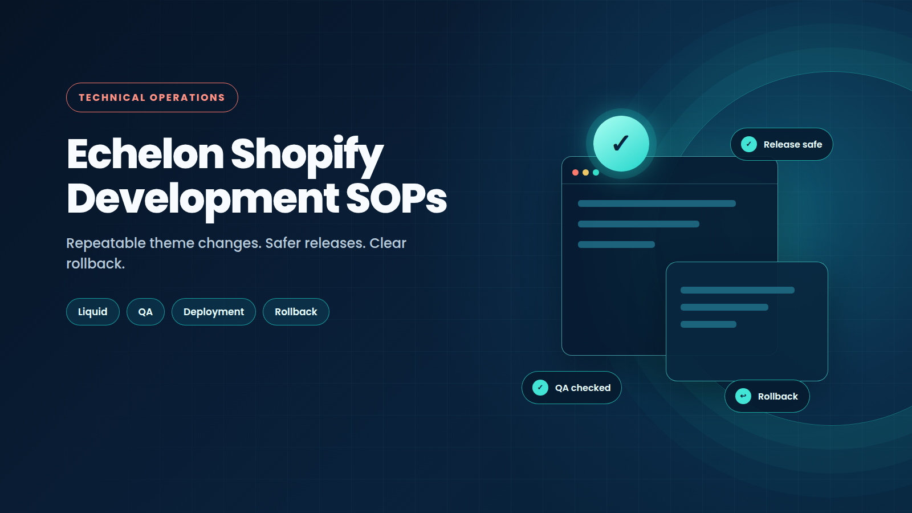

# Echelon Fit - Shopify Development SOPs

  

This repository contains Standard Operating Procedures, implementation references and supporting code for custom Shopify development on the Echelon Fit storefronts. The material covers storefront operations, Liquid architecture, product-page behavior, membership presentation, shipping, promotional modules, product configuration and deployment practices.

The documents are intended for Echelon ecommerce developers, Shopify administrators and technical operators who maintain the company storefronts. Before changing a live theme, confirm the target store, theme ID, affected files and rollback path.

## Storefronts covered

| Storefront | Website | Coverage |
|---|---|---|
| Echelon US | [echelonfit.com](https://echelonfit.com/) | US Shopify storefront development and operations |
| Echelon UK | [echelonfit.uk](https://echelonfit.uk/) | UK product templates, memberships, shipping and theme development |
| Echelon CA | [echelonfit.ca](https://echelonfit.ca/) | Canadian storefront development and operations |

## Available SOPs

The repository currently contains the following SOP documents. Two documents use the `SOP-009` filename prefix because they were created for separate implementation tracks. Their filenames are preserved for history; avoid assigning another document the same identifier until the numbering is normalized in a dedicated change.

| Identifier | Document | Scope |
|---|---|---|
| SOP-001 | [Editing the Membership Upgrade Modal](SOP-001-membership-upgrade-modal.md) | Add, remove or update membership-modal freebies across Theme Customizer blocks and the `membership-popup.liquid` cart logic. |
| SOP-002 | [Bazaarvoice Coding Setup and Troubleshooting](SOP-002-bazaarvoice-coding-setup.md) | Replace or troubleshoot Klaviyo widgets with Bazaarvoice inline ratings and custom Liquid star-rating behavior. |
| SOP-003 | [Ship-X Shipping Policy and Setup](SOP-003-ship-x-shipping-policy.md) | Configure Ship-X scenarios, product tags and interactions with Shopify manual shipping rates. |
| SOP-004 | [SSL Setup and Validation via PuTTY](SOP-004-ssl-setup-putty.md) | Connect through the required jump-host workflow and validate or correct Nginx SSL configuration. |
| SOP-005 | [Upsell and Cross-Sell App: Selleasy](SOP-005-upsell-selleasy-app.md) | Configure Selleasy campaigns, theme app blocks and troubleshooting procedures. |
| SOP-006 | [Managing Membership Option Badges](SOP-006-membership-option-badges.md) | Manage membership option badges on Echelon product pages, including pricing, savings and presentation rules. |
| SOP-007 | [Adding or Updating Optional Icons in Columns with Modals](SOP-007-columns-with-modals-icons.md) | Add, remove or update optional icon blocks and modal content in the Columns with Modals section. |
| SOP-008 | [Managing the Free Shipping Badge on Membership Product Cards](SOP-008-free-shipping-badge-membership.md) | Maintain free-shipping badge behavior and preserve the UK membership delivery rule. |
| SOP-009A | [ThermaChill Main Unit PDP and Mix-and-Match Garments](SOP-009-thermachill-main-unit-mix-match.md) | Maintain the ThermaChill main-unit PDP, garment selection cards, variant and inventory behavior, configuration subtotal and cart flow. |
| SOP-009B | [UK Dynamic Bike Product Template](SOP-009-uk-dynamic-bike-product-template.md) | Maintain the additive `product.dynamic-bike` template, including fixed bike presentation, dynamic PDP data, UK membership cards, specifications, deployment, testing and rollback. |
| SOP-010 | [UK Dynamic FitQuest Product Template](SOP-010-uk-dynamic-fitquest-product-template.md) | Maintain the additive `product.dynamic-fitquest` template, including dynamic FitQuest PDP data, elliptical-only membership cards, one native purchase action, combined cart behavior, validation, deployment and rollback. |
| SOP-011 | [UK Two-Part Equipment and Screen Cart Flow](SOP-011-uk-two-part-screen-line-cart-flow.md) | Maintain the dedicated Strength+ and Row-7s cart flow so each equipment SKU adds its corresponding screen SKU as a separate line, with Online Store availability, validation and rollback guidance. |
| SOP-012 | [Collection Page CTA Links](SOP-012-collection-page-cta-links.md) | Configure, validate and release collection-page hero CTAs, including stable product-grid anchors, Liquid implementation, QA, troubleshooting and rollback. |
| SOP-013 | [Designed and Engineered in the USA PDP Badge](SOP-013-usa-designed-engineered-badge-pdp.md) | Maintain the reusable USA badge across PDP purchase render paths, including placement, accessibility, responsive QA, publication and rollback. |
| SOP-014 | [UK Product2024 Secondary Product Cart Mapping](SOP-014-uk-product2024-secondary-product-cart.md) | Configure a Product2024 product-reference metafield so an optional secondary physical product, such as a packaged-separately screen, is added as a separate cart line with the selected membership. |
| SOP-015 | [ThermaChill Recliner Chair Gift](SOP-015-thermachill-chair-gift.md) | Maintain the Echelon US consumer-site promotion that adds one Recliner Chair to the ThermaChill cart and discounts only the marked gift line through a Shopify Product Discount Function. |
| SOP-016 | [SEO Audit and Controlled Shopify Theme Release](SOP-016-seo-audit-controlled-theme-release.md) ([PDF](SOP-016-seo-audit-controlled-theme-release.pdf)) | Audit technical SEO, test narrow theme changes in QA, deploy only approved files, verify the live pullback, and document rollback and post-deployment validation. |
| SOP-017 | [UK Member Reward Zone Two-Part Cart Validation](SOP-017-uk-member-reward-zone-two-part-cart-validation.md) | Verify that authenticated member purchase paths add both equipment and companion screen SKUs, trace the responsible handler, and validate safely before deployment. |
| SOP-018 | [Scheduled Sales-Channel Publication Flow](SOP-018-scheduled-sales-channel-publication-flow.md) | Design, validate and operate a scheduled Shopify Flow that removes inventory-state-tagged products from one approved sales channel without changing Online Store publication or product data. |
| SOP-019 | [UK Product2026 Responsive Product Template](SOP-019-uk-product2026-responsive-template.md) | Maintain the responsive Product2026 price row, eligible delivery message, membership presentation and scoped product-image lightbox for products already assigned to the template. |
| SOP-020 | [Tub Template Chiller Add-ons](SOP-020-tub-template-chiller-add-ons.md) | Configure, validate and troubleshoot optional chiller add-ons, product media fallbacks and product-specific template conditions on plunge-tub pages. |
| SOP-021 | [Product2025 Anchor Navigation](SOP-021-product2025-anchor-navigation.md) | Connect custom Product2025 navigation labels to real Features, Specs, Membership and Accessories sections without changing purchase logic. |
| SOP-022 | [Recovery Menu Category Order](SOP-022-recovery-menu-category-order.md) | Reorder Recovery category items in Shopify Navigation while preserving collection destinations and responsive mega-menu behavior. |
| SOP-023 | [Dual-Brand Logo Same-Tab Links](SOP-023-dual-brand-logo-same-tab-links.md) | Keep the PRIMAL hit area in the combined brand logo in the current browser tab across desktop and mobile header instances. |
| SOP-024 | [Accessibility Launcher and Flash Speed Load Order](SOP-024-accessibility-launcher-flash-speed.md) | Release a small accessibility options launcher without allowing the performance optimizer to prevent its runtime from initializing. |
| SOP-025 | [Guarding Optional Liquid Image URLs](SOP-025-accessibility-invalid-liquid-url-guards.md) | Prevent empty optional image settings from producing invalid Liquid output or CSS background URLs in tested storefront sections. |
| SOP-026 | [WCAG 2.2 AA Theme Audit and Remediation](SOP-026-wcag22-theme-audit-remediation.md) | Audit a theme with automated and keyboard tests, fix issues in an unpublished copy, update the accessibility statement and release only the changed files. |
| SOP-027 | [Premier Monthly 30-Days Free Trial Operations](SOP-027-premier-30-days-free-trial-operations.md) | Check, change, deploy and roll back the dynamic first-month-free membership discount and its theme messaging. |
| SOP-028 | [Shop Pay Installments Fallback for the PDP Financing Slot](SOP-028-shop-pay-installments-financing-fallback.md) | Show Shopify's monthly price message when the financing widget is empty, and scope template CSS so it cannot hide PDP prices. |
| SOP-029 | [In-App Browser and Mobile Checkout Testing](SOP-029-in-app-browser-checkout-testing.md) | Test the full mobile checkout in Instagram, Facebook and Snapchat browsers without placing a real order. |
| SOP-030 | [UK Per-Product Pre-Order Message](SOP-030-uk-per-product-preorder-message.md) | Enable or remove a pre-order message and "Pre-order now" label on one UK product through a metafield. |

## SEO Documentation

| Document | Description |
|---|---|
| [Echelon Fit US SEO Improvements: Technical Case Study](SEO-CASE-STUDY-echelon-fit-us-2026-10.md) | Sanitized technical case study covering the approved SEO changes, controlled release process, measured post-deployment improvements, remaining findings, and recommended next phase. |

## Recent consumer-site accomplishment

Implemented and deployed the ThermaChill Recliner Chair gift flow for the Echelon US consumer storefront at [echelonfit.com](https://echelonfit.com/). The product page adds the chair as a marked cart line, while a fail-closed Shopify Product Discount Function discounts only one eligible gift line. The ThermaChill Main Unit and selected garments remain paid. The implementation includes product-reference configuration, duplicate-gift protection, controlled production validation and rollback guidance. See [SOP-015](SOP-015-thermachill-chair-gift.md).

## UK Dynamic Bike Template Reference Files

| File | Description |
|---|---|
| [Manual Installation Guide](MANUAL-UK-DYNAMIC-BIKE-TEMPLATE.md) | Manual installation, exact Shopify file paths, product assignment and test procedure for `product.dynamic-bike`. |
| [Dynamic Bike Template Reference](REFERENCE-UK-DYNAMIC-BIKE-TEMPLATE.md) | Quick reference for the additive architecture, UK metafields, existing Premier membership products, data behavior and validation requirements. |

## Membership and Dynamic Template Context Files

| File | Description |
|---|---|
| [US Membership Subscription Billing Context](docs/reference/US-MEMBERSHIP-SUBSCRIPTION-BILLING-CONTEXT.pdf) | PDF reference explaining the verified US membership PDP flow, Product references, Liquid snippets, cart-state behavior, subscription selling-plan boundary, and recurring-billing verification requirements. |
| [US Membership Subscription Billing Source](docs/reference/US-MEMBERSHIP-SUBSCRIPTION-BILLING-CONTEXT.typ) | Typst source for the US membership and subscription context PDF. |
| [UK Dynamic Template Chat Context](docs/reference/ECHELON-UK-DYNAMIC-TEMPLATE-CHAT-CONTEXT.md) | Master context file for the UK implementation chat, including US evidence, UK target architecture, Liquid behavior, metafields, product references, template schema, and acceptance tests. |
| [US-UK Membership Architecture Comparison](docs/reference/US-UK-MEMBERSHIP-ARCHITECTURE-COMPARISON.md) | Comparison separating verified US behavior from the recommended UK profile-based architecture. |
| [US Membership Replication Guide](docs/reference/US-MEMBERSHIP-REPLICATION-GUIDE.md) | Detailed replication guide for the US membership Product references and PDP snippets. |
| [UK PDF Context Findings](docs/reference/UK-PDF-CONTEXT-FINDINGS.md) | Extracted findings from the supplied UK dynamic-template context document. |
| [Original UK Dynamic Template Context](docs/reference/source/Correct_Solution_One_100_Dynamic_Product_Template.pdf) | Source PDF supplied as architectural context for the UK dynamic template. |

The recommended reading order is to start with the US PDF for the billing boundary, then read the master UK chat context, then use the US-UK comparison and UK PDF findings while implementing. The Typst source is included so the US PDF can be maintained and regenerated. These files are reference documentation only; they do not modify a Shopify store by themselves.

## Documentation standard

All SOPs in this repository are internal operating documentation for Echelon developers, Shopify administrators and technical operators. The document author is **Nícolas Cartín Reyes**. SOPs must contain actionable procedures, prerequisites, affected files or configuration, validation criteria, troubleshooting guidance and rollback instructions. They must not contain agent identity, chat history, sandbox paths, temporary audit narration, private credentials or other notes that are useful only to the document-generation process.

## ThermaChill companion files

| File | Description |
|---|---|
| [ThermaChill SOP PDF](SOP-009-thermachill-main-unit-mix-match.pdf) | PDF companion to the ThermaChill main-unit and mix-and-match garment SOP. |

## Reference Code and Implementation Artifacts

| File | Description |
|---|---|
| [membership-popup.liquid](membership-popup.liquid) | Full Liquid, HTML and JavaScript source for the membership upgrade modal, including its cart behavior. |

The SOP documents may refer to additional theme files, snippets or assets from the relevant Shopify theme. Those implementation files are intentionally not duplicated here unless explicitly listed as reference code. Each SOP should identify the target theme, file path and deployment scope before a change is made.

## How to use this repository

Start with the SOP that matches the requested change. Read its scope, prerequisites, affected files, validation steps and rollback procedure before editing code or configuration. Use the linked supporting manual when the SOP involves a product template installation or a repeatable operational workflow.

For a live-theme change, create or pull a local backup, work on a dedicated branch or isolated working copy, validate the changed files, deploy only the intended files and verify the live result. Do not overwrite unrelated product templates, delete existing theme files or introduce US-specific values into UK implementation files.

## Naming and maintenance notes

The existing filenames are preserved to avoid breaking historical links. The duplicate `SOP-009` prefix should be normalized in a future repository-maintenance change, preferably by assigning a new sequential identifier to one document and updating all inbound links together.

When adding a new SOP, include a unique identifier, a clear implementation scope, prerequisites, affected files, step-by-step procedure, validation criteria, troubleshooting guidance and rollback instructions. Add the document to the Available SOPs table and place supporting manuals or companion assets in the appropriate reference section. Context files must distinguish verified live-store behavior from proposed architecture, identify the exact source files and metafields, and record any unverified JavaScript or subscription-app behavior before implementation.

## Technology covered

`Shopify` · `Shopify Flow` · `Liquid` · `JavaScript` · `HTML` · `CSS` · `Theme Customization` · `Metafields` · `Product and Variant Data` · `Inventory` · `Sales Channels` · `Shipping` · `Membership Presentation` · `Ecommerce Operations`

## References

1. [Echelon US storefront](https://echelonfit.com/)
2. [Echelon UK storefront](https://echelonfit.uk/)
3. [Echelon CA storefront](https://echelonfit.ca/)
4. [Shopify theme architecture](https://help.shopify.com/en/manual/online-store/themes/theme-structure)
5. [Shopify theme code editor](https://help.shopify.com/en/manual/online-store/themes/customizing-themes/edit-code/edit-theme-code)
6. [Shopify metafields](https://help.shopify.com/en/manual/custom-data/metafields)
7. [Echelon SOP repository](https://github.com/NikoCartin/echelon-sops)
